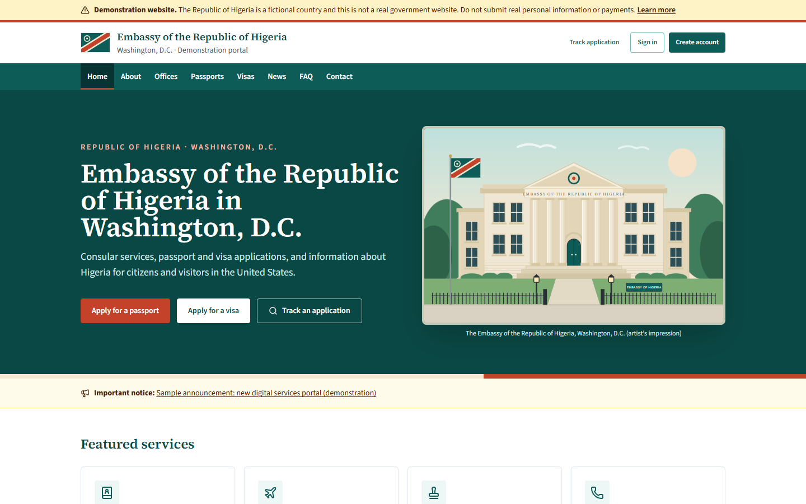
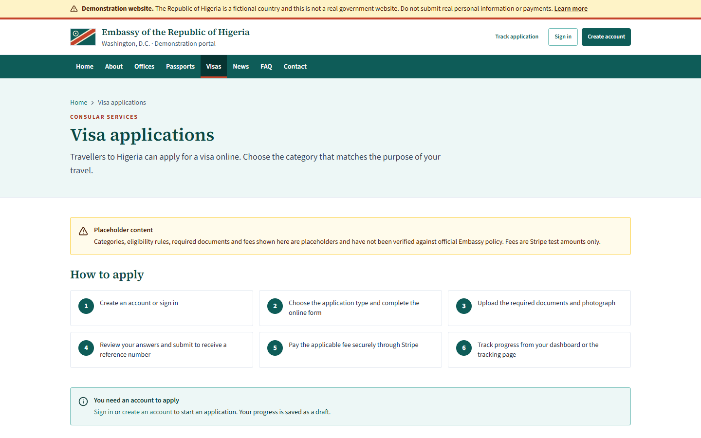
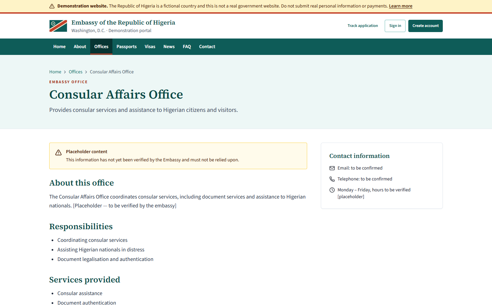
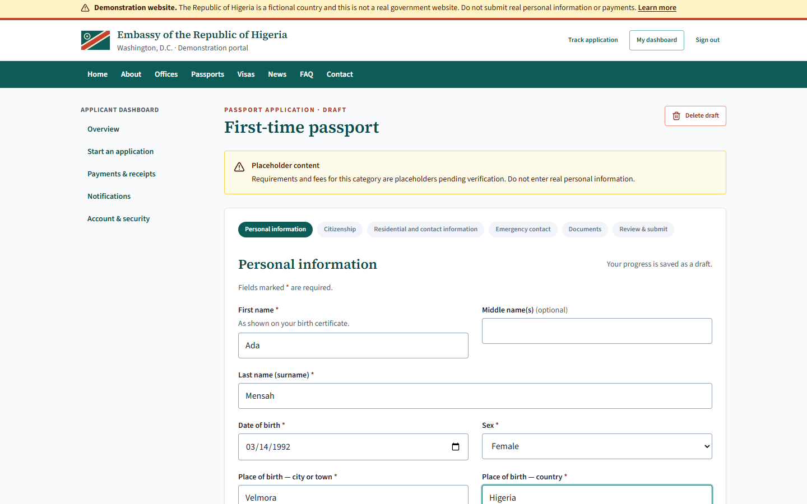
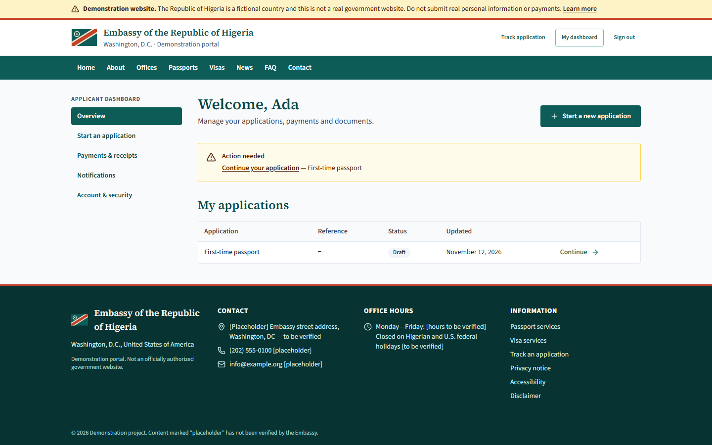
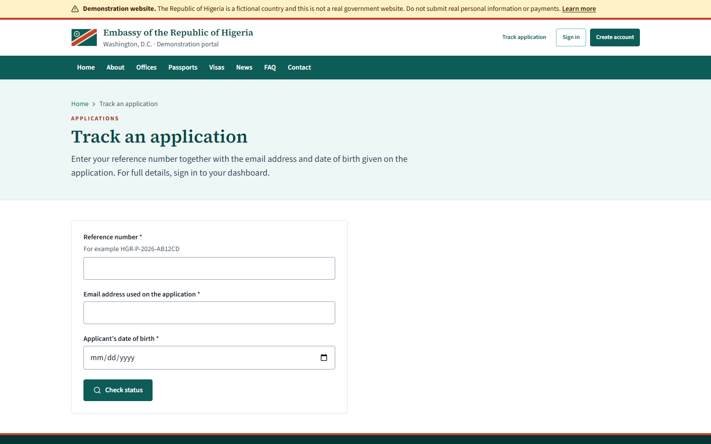
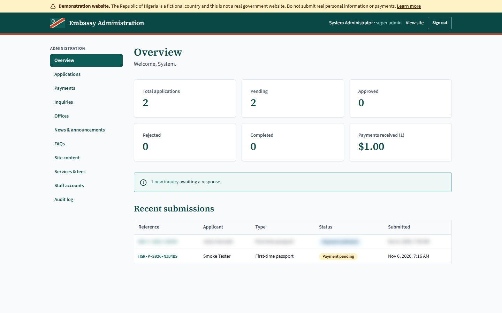
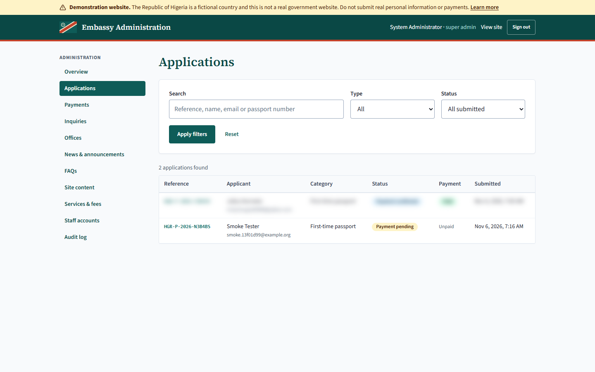
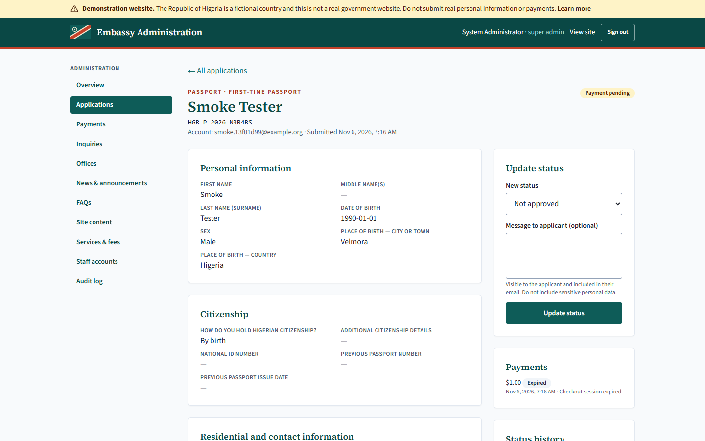
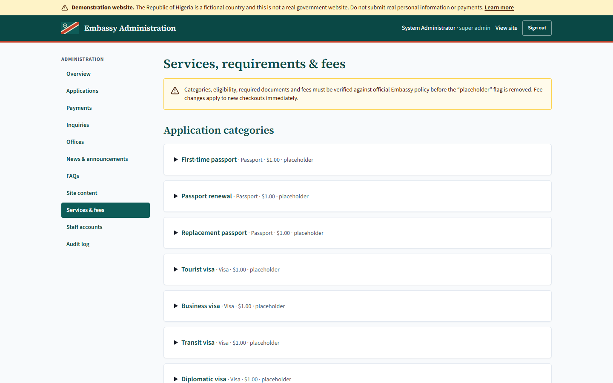

# Embassy of the Republic of Higeria – Washington, D.C. · Digital Services Portal (Demonstration)

> **The Republic of Higeria is a fictional country.** This is a demonstration platform, not a real
> government website. Do not submit real applications, personal data or payments. All names,
> contacts, fees, requirements and policies in the seed data are clearly labelled placeholders.
> Higeria’s flag (a Lagoon-teal field, an Ember-coral diagonal band edged in Ivory, and an Ivory
> “Dawn Ring”) and its teal / coral / ivory colour theme are original designs.

**Live demo:** https://embassy-of-higeria.vercel.app (Vercel + Neon PostgreSQL, Stripe test mode,
`STORAGE_DRIVER=database`, `UPLOAD_MAX_MB=4`).

## About this project

Embassy of Higeria is a full-stack demonstration of a digital services portal for an embassy. The
Republic of Higeria is a fictional country invented for this project, with its own original flag and a
teal, coral and ivory colour scheme, so the platform can be shown publicly without impersonating any
real government.

The portal recreates the main jobs an embassy website performs. Citizens can apply for a first-time,
renewal or replacement passport, and visitors can apply for tourist, business, transit, diplomatic,
official or multiple-entry visas. Each application is a guided, multi-step form that saves drafts
automatically, validates every field in both the browser and on the server, and ends with a review page
and a unique reference number. Applicants upload photographs and supporting documents with progress
bars and previews, pay fees through Stripe Checkout, download PDF receipts, and follow their
application’s progress from a personal dashboard or a public tracking page.

Embassy staff work in a separate administration dashboard. They search and filter applications, open
documents through links that expire after five minutes, move applications through a defined review
workflow, request additional documents and keep internal notes. Administrators manage office pages,
news, FAQs, homepage content, fees and document requirements without touching code, and create staff
accounts whose permissions are limited by role and by office. Every sensitive action is written to an
audit log.

Security was a core requirement. Payments are confirmed only by
signature-verified Stripe webhooks that cannot be processed twice. Uploaded files are checked by
their actual content, PDFs containing scripts are rejected, and documents are never stored at a public
address. Sessions are stored as hashes, sign-in attempts are rate-limited, and every state-changing
request is protected against cross-site request forgery.

The application is built with Next.js 15, React 19 and Tailwind CSS, uses PostgreSQL with Prisma for
data and Stripe for payments, and is deployed on Vercel with a Neon database. It follows WCAG 2.2 AA
accessibility practices, works on phones, tablets and desktops, and is covered by 35 automated
integration tests that run against a real PostgreSQL database. All official-looking content is clearly
labelled placeholder material.

## Screenshots

> Captured from the live demo. Applicant data shown belongs to test accounts; any other applicant’s
> details are blurred.

| Homepage | Homepage on a phone |
|---|---|
|  |  |

| Visa services, fees and required documents | Embassy office page |
|---|---|
|  |  |

| Multi-step application form | Applicant dashboard |
|---|---|
|  |  |

| Public application tracking | Admin overview |
|---|---|
|  |  |

| Admin application search | Admin application review |
|---|---|
|  |  |

| Admin services, fees and requirements |
|---|
|  |

---

## Contents

1. [Features](#features)
2. [Tech stack](#tech-stack)
3. [Quick start (local development)](#quick-start-local-development)
4. [Environment variables](#environment-variables)
5. [Database](#database)
6. [Stripe setup](#stripe-setup)
7. [File storage](#file-storage)
8. [Email](#email)
9. [Testing](#testing)
10. [Deployment (Vercel)](#deployment-vercel)
11. [Security model](#security-model)
12. [Data retention & backups](#data-retention--backups)
13. [Before going live — checklist](#before-going-live--checklist)
14. [Project structure](#project-structure)

---

## Features

**Public site:** homepage (welcome, Ambassador’s message, notices, quick links, office hours,
emergency contact), About, nine Embassy office pages (description, responsibilities, services,
contacts, hours, forms, FAQs, inquiry form), passport and visa service pages with live fees and
requirements, news with categories, FAQ by topic, contact page with Google Maps, application
tracking, privacy/accessibility/disclaimer pages, sitemap and robots.txt.

**Applicants:** account registration and sign-in, multi-step application wizard with drafts
saved on every step, document uploads with progress bars, previews, replace and remove, a review
page, submission with a reference number, Stripe Checkout, PDF receipts, status timeline,
additional-document requests, in-app notifications and emails, and password changes.

**Administrators and staff:** overview statistics, application search and filters, document review
through expiring links, status workflow, internal notes, document requests, payment history and CSV
reports, office management, news/FAQ/homepage/About editing with image uploads, categories,
fees and document requirements, staff accounts with roles, per-permission and per-office access,
inquiry management, and an audit log.

## Tech stack

Next.js 15 (App Router, JavaScript) · React 19 · Tailwind CSS 3 · Lucide React · React Hook Form + Zod ·
PostgreSQL + Prisma 6 · Stripe Checkout + webhooks · S3-compatible private storage · Nodemailer (SMTP) ·
pdf-lib (receipts) · Vitest. See [docs/ARCHITECTURE.md](docs/ARCHITECTURE.md) for the design.

## Quick start (local development)

Requirements: **Node.js 20+**. PostgreSQL is optional locally: the project can run a real PostgreSQL
server from npm (`embedded-postgres`) without Docker.

```bash
npm install
cp .env.example .env            # then set APP_SECRET (command below)
node -e "console.log(require('crypto').randomBytes(48).toString('base64url'))"

# Terminal 1 — local PostgreSQL on port 5433 (skip if you have your own PostgreSQL)
npm run db:local

# Terminal 2
npx prisma migrate deploy       # create tables
npm run db:seed                 # placeholder offices, categories, FAQs, content
ADMIN_EMAIL=you@example.org ADMIN_PASSWORD='Choose-A-Strong-Pass1' npm run admin:create
npm run dev                     # http://localhost:3000
```

Sign in at `/login` with the admin account to reach `/admin`. Register a separate applicant
account to try the application flow. On Windows PowerShell, set variables first:
`$env:ADMIN_EMAIL='…'; $env:ADMIN_PASSWORD='…'; npm run admin:create`.

## Environment variables

All variables are documented in [.env.example](.env.example). Secrets live only in environment
variables and are never sent to the browser (no `NEXT_PUBLIC_` secrets exist).

| Variable | Purpose |
|---|---|
| `APP_URL` | Public base URL (Stripe redirects, email links, sitemap, CSRF origin check) |
| `DATABASE_URL` | PostgreSQL connection string |
| `APP_SECRET` | ≥32 random chars; signs local-storage download links |
| `STRIPE_SECRET_KEY`, `STRIPE_WEBHOOK_SECRET` | Stripe (test-mode keys outside production) |
| `STORAGE_DRIVER` + `S3_*` / `LOCAL_STORAGE_DIR` | Private document storage |
| `EMAIL_TRANSPORT`, `EMAIL_FROM`, `SMTP_*`, `INQUIRY_NOTIFY_EMAIL` | Transactional email |
| `SESSION_TTL_HOURS_*`, `RETENTION_DAYS_*` | Session lifetime and data retention |
| `ALLOW_INDEXING` | Leave unset; set `true` only after official approval |

## Database

Schema: [prisma/schema.prisma](prisma/schema.prisma) covers users, sessions, staff↔office
assignments, offices, announcements, FAQs, site settings, configurable categories, document
requirements, service fees, applications with passport/visa detail tables, documents, document
requests, status history, internal notes, payments, payment transactions, processed Stripe events,
inquiries, notifications, audit logs and rate limits. It includes foreign keys, unique constraints
and indexes.

```bash
npm run db:migrate        # development: create a new migration after editing the schema
npm run db:deploy         # production: apply pending migrations
npm run db:seed           # idempotent; never overwrites edited content
npm run db:studio         # browse data
```

## Stripe setup

1. Create a Stripe account and stay in **Test mode**.
2. Copy the secret key (`sk_test_…`) into `STRIPE_SECRET_KEY`. The app refuses live keys outside production.
3. Webhooks:
   - **Local:** install the Stripe CLI and run
     `stripe listen --forward-to localhost:3000/api/stripe/webhook`. Copy the printed `whsec_…`
     into `STRIPE_WEBHOOK_SECRET`.
   - **Deployed:** in the Stripe dashboard, add an endpoint `https://YOUR_DOMAIN/api/stripe/webhook`
     with the events `checkout.session.completed`, `checkout.session.async_payment_succeeded`,
     `checkout.session.async_payment_failed` and `checkout.session.expired`.
4. Pay with test card `4242 4242 4242 4242`, any future expiry date, any CVC.

How it works: the browser sends only an application ID. The server computes the amount from the
fee configuration and creates a Checkout Session (reusing an open one to avoid duplicates). Only a
**signature-verified webhook** can mark a payment as successful. The amount and currency are checked,
and every Stripe event ID is recorded once, so replayed or duplicate events cannot double-process.
The success page reads the status from the database; it never trusts the redirect itself. Card
data never touches this server.

## File storage

- **`STORAGE_DRIVER=local`** (development only). Files go to `./storage` (git-ignored, outside
  `public/`) and are served only through HMAC-signed links that expire after 5 minutes. The app
  refuses this driver in production unless `ALLOW_LOCAL_STORAGE_IN_PRODUCTION=true`.
- **`STORAGE_DRIVER=s3`** (production). Use a **private** bucket (AWS S3, Cloudflare R2,
  Backblaze B2, MinIO). Block all public access, enable default server-side encryption and
  versioning, and grant the access key only `s3:PutObject`, `s3:GetObject` and `s3:DeleteObject`
  on that bucket. Downloads use 5-minute presigned URLs.

Upload checks run on the server: size limit (≤10 MB hard cap, per-document configurable), real file
type detected from content (JPEG/PNG/PDF only), PDFs containing JavaScript, launch actions,
embedded files or encryption are rejected, polyglot images are rejected, files get random UUID
names, and a SHA-256 hash is stored. **Recommended for production:** add malware scanning (for
example S3 + Amazon GuardDuty Malware Protection, or ClamAV) before staff open files.

## Email

`EMAIL_TRANSPORT=console` prints emails to the server log in development. For real delivery set
`EMAIL_TRANSPORT=smtp` and the SMTP credentials of a transactional provider (Postmark, Amazon SES,
Resend, SendGrid…). Configure SPF, DKIM and DMARC for the sending domain. Emails contain only the
recipient’s first name and the reference number, with no other personal data.

Templates ([src/lib/email/templates.js](src/lib/email/templates.js)) cover registration, submission
and reference number, payment success and failure, document requests, status changes,
approval and rejection, and inquiry acknowledgements and staff alerts.

## Testing

```bash
npm test
```

The test suite starts its own throwaway PostgreSQL server (port 5434), applies migrations, seeds it,
and runs **35 integration tests** against the real route handlers:

| # | Area | File |
|---|---|---|
| 1 | Registration, login, lockout, logout, CSRF | `tests/auth.test.js` |
| 2–3 | Passport and visa submission, validation | `tests/applications.test.js` |
| 4 | Upload validation, malicious files, signed links, staff scoping | `tests/uploads.test.js` |
| 5–7 | Checkout, webhook signature verification, confirmation, idempotency, amount mismatch, failures | `tests/payments.test.js` |
| 8 | Status tracking and rate limiting | `tests/applications.test.js` |
| 9–11 | Admin auth, review workflow, RBAC and department scope, role escalation | `tests/admin.test.js` |

Outbound Stripe API calls are stubbed in tests. Webhook signatures are generated and verified
with the real Stripe SDK. To use an existing database instead of the embedded one, set
`TEST_DATABASE_URL` to a **dedicated, empty** test database.

## Deployment (Vercel)

1. Create a managed PostgreSQL database (Neon, Supabase, Vercel Postgres, RDS) with automated backups.
2. Create a private S3-compatible bucket (see [File storage](#file-storage)).
3. Import the repository into Vercel and set all environment variables (production values;
   `APP_URL=https://your-domain`).
4. Build command: `prisma migrate deploy && npm run build` (or run `npm run db:deploy` from CI before deploying).
5. Run `npm run db:seed` once, and `npm run admin:create` once (from a trusted machine with the
   production `DATABASE_URL`).
6. Add the Stripe webhook endpoint (above) and set `STRIPE_WEBHOOK_SECRET`.
7. Schedule `npm run retention:purge` daily (GitHub Actions cron or a small worker with DB access).

Any Node.js 20 host works. Run `npm run build && npm start` behind HTTPS (HSTS and
`upgrade-insecure-requests` are enabled automatically when `APP_URL` is `https://`).

## Security model

| Threat | Control |
|---|---|
| Credential attacks | bcrypt (cost 12), 12+ char passwords, generic errors, per-IP and per-email rate limits, 15-min lockout after 5 failures |
| Session theft | 256-bit random tokens, stored **hashed**; `HttpOnly`, `Secure`, `SameSite=Lax`, `__Host-` prefix in production; staff sessions expire after 8 h; revoked on password/role change |
| CSRF | SameSite cookies **and** Origin/`Sec-Fetch-Site` check on every state-changing API request |
| Broken access control | Every route checks the session against the DB; ownership in queries; RBAC permissions + office scoping; 404 (not 403) for others’ records |
| Injection / XSS | Prisma parameterised queries; React escaping; no `dangerouslySetInnerHTML`; strict CSP; CSV formula-injection neutralised |
| Uploads | Content sniffing, PDF active-content rejection, size caps, random keys, private storage, expiring links, `nosniff` + sandbox CSP on downloads |
| Payments | Server-side amounts, verified webhooks, idempotent processing, amount check, no card data stored |
| Abuse | DB-backed rate limits (shared across serverless instances), honeypot on contact form |
| Accountability | Audit log of sign-ins, document access, status changes, configuration and account changes |
| Open redirects | `next` parameter restricted to same-site relative paths |

## Data retention & backups

`npm run retention:purge` deletes stored documents of applications decided more than
`RETENTION_DAYS_DOCUMENTS` days ago, deletes abandoned drafts older than `RETENTION_DAYS_DRAFTS`,
and clears expired sessions and rate-limit counters. Payment records are kept for financial audit.
**The retention periods must be set by the Embassy’s legal and records policy.**

Backups: enable your database provider’s automated daily backups and point-in-time recovery, and
bucket versioning with lifecycle rules. Test a restore before go-live.

## Before going live — checklist

- [ ] Written approval from Embassy authorities; the demonstration banner and disclaimer are removed only then
- [ ] Every office, contact detail, hour, fee, category, eligibility rule, requirement and FAQ verified; “placeholder” flags cleared
- [ ] Authorised coat-of-arms asset supplied (see `src/components/site/FlagMark.js`) and licensed photography uploaded
- [ ] Privacy policy, terms and retention periods reviewed by counsel
- [ ] Independent penetration test and accessibility audit (WCAG 2.2 AA)
- [ ] Malware scanning for uploads; WAF/DDoS protection in front of the site
- [ ] Stripe account verified; switched to live keys; webhook secret rotated
- [ ] MFA added for staff accounts (recommended next feature) and staff trained
- [ ] Monitoring/alerting on errors, webhook failures and audit anomalies
- [ ] `ALLOW_INDEXING=true` and `robots` metadata updated only after launch approval

## Project structure

```
prisma/              schema.prisma, migrations/, seed-data.mjs (placeholders), seed.mjs
scripts/             local-postgres.mjs, create-admin.mjs, retention-purge.mjs
src/middleware.js    redirects signed-out visitors away from /dashboard and /admin
src/app/(site)/      public pages
src/app/dashboard/   applicant portal
src/app/admin/       administration dashboard
src/app/api/         route handlers (auth, applications, documents, payments, stripe, admin…)
src/components/      site, ui, forms, applications, admin
src/lib/             prisma, auth, rbac, http, storage, uploads, stripe, payments, fees,
                     applications, email, validation, rate-limit, audit, receipt
tests/               Vitest integration tests
docs/ARCHITECTURE.md design and roadmap
```
